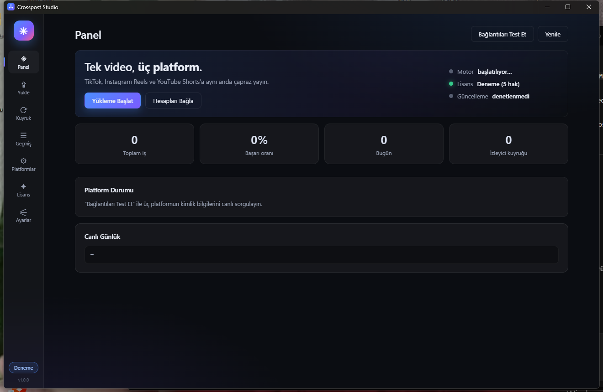
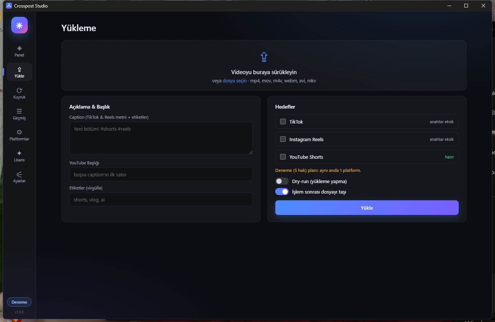
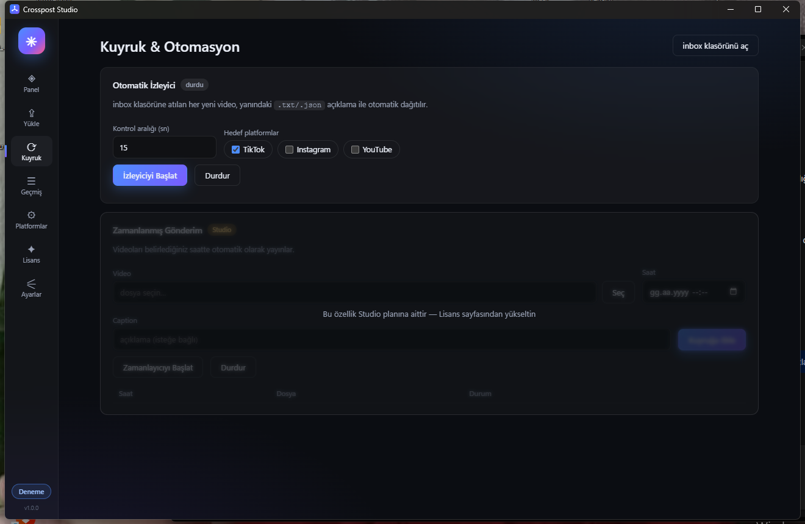
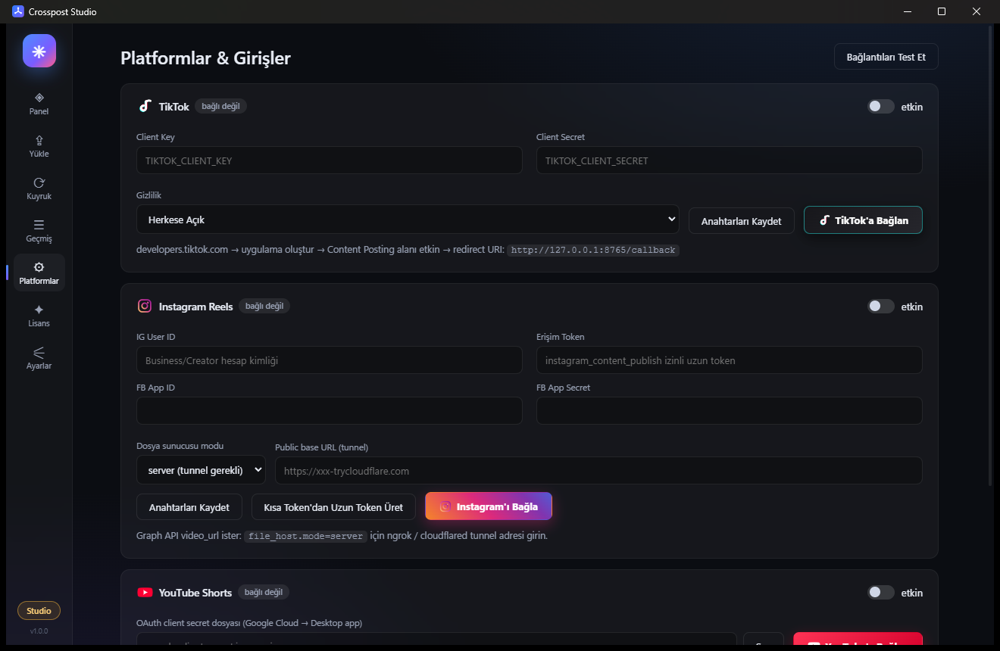
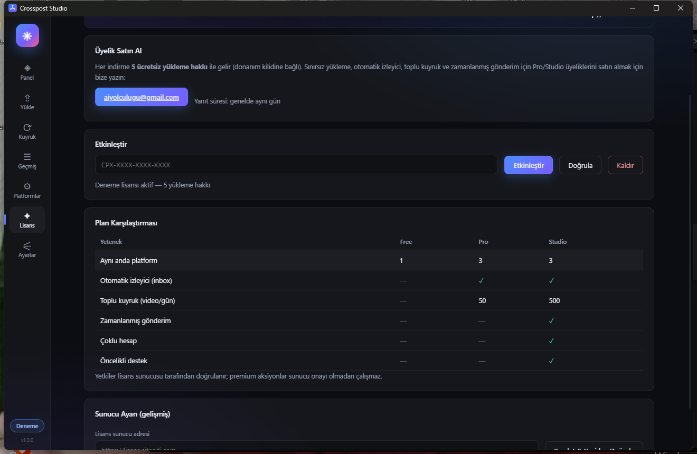
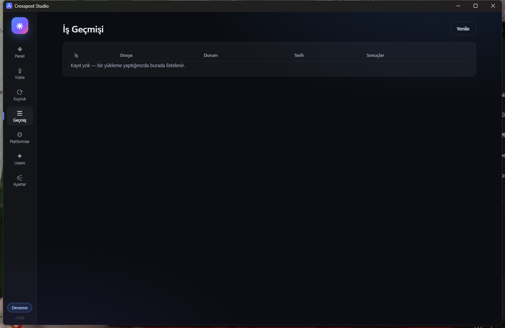

  

<h1 align="center">Crosspost Studio</h1>

  <b>Windows için TikTok · Instagram Reels · YouTube Shorts çapraz yükleme (crosspost) uygulaması</b> 
  Tek bir videoyu üç platforma aynı anda otomatik yayınlayın

  🌐 <b>English:</b> Crosspost Studio is a Windows desktop app that cross-posts one video to
  TikTok, Instagram Reels and YouTube Shorts — with an auto watch-folder, batch queue,
  scheduled publishing, hardware-locked licensing and silent auto-updates.
  Everyone gets <b>5 free uploads</b> on install. Paid plans: Pro &amp; Studio.

  <b>Tek video → TikTok · Instagram Reels · YouTube Shorts</b> 
  Windows masaüstü uygulaması — tek tıkla çapraz yayın

  
  
  
  

---

## 🎬 Ekran Görüntüleri

| Panel | Yükleme |
| --- | --- |
|  |  |

| Kuyruk & Otomasyon | Platformlar & Girişler |
| --- | --- |
|  |  |

| Lisans | Geçmiş |
| --- | --- |
|  |  |

---

## ✨ Özellikler

- **Çapraz yayın** — aynı videoyu TikTok, Instagram Reels ve YouTube Shorts'a gönderir
- **Tek pano** — sürükle-bırak yükleme, açıklama + hashtag editörü, canlı log
- **Otomatik izleyici** — `inbox/` klasörüne düşen her videoyu otomatik dağıtır (Pro+)
- **Zamanlanmış gönderim** — videoları belirlediğiniz saate programlayın (Studio)
- **Toplu kuyruk** — günde yüzlerce videoyu sırayla işleyin (Pro/Studio)
- **Platform girişi GUI'den** — API anahtarları, OAuth ve tarayıcı yetkilendirme uygulama içinden yapılır
- **Hesap güvenliği** — anahtarlar Windows DPAPI ile şifrelenir, hiçbir zaman sunucuya gönderilmez
- **Otomik güncelleme** — yeni sürüm çıktığında uygulama kendini sessizce günceller
- **Donanım kilidi** — lisans cihaza bağlıdır, paylaşılamaz

## 📦 Kurulum

1. [**CrosspostStudio-Setup-1.0.0.exe**](https://github.com/RetroNyym/crosspost-desktop/releases/latest) dosyasını indirin
2. Çalıştırın → kurulum tamamlanır → uygulama açılır
3. **Platformlar** sayfasından hesaplarınızı bağlayın
4. **Yükle** sayfasından videonu seçip hedef platformları işaretleyin → **Yükle**

> Otomatik güncelleme etkindir: uygulama açılışta yeni sürümü denetler ve arka planda kurar.

## 🎁 Ücretsiz 5 Hak

Programı **indiren herkese 5 ücretsiz yükleme hakkı** verilir:

- Anahtar girmeye gerek yok — ilk açılışta donanımınıza otomatik tanımlanır
- Her gerçek yükleme 1 hak düşer (dry-run denemeleri hak harcamaz)
- Haklar bittiğinde Lisans sayfasındaki buton sizi üyeliğe yönlendirir

## 💎 Üyelik Planları

| | Deneme | Pro | Studio |
| --- | --- | --- | --- |
| Aynı anda platform | 1 | 3 | 3 |
| Toplam yükleme hakkı | **5** | Sınırsız | Sınırsız |
| Otomatik izleyici | — | ✓ | ✓ |
| Toplu kuyruk (video/gün) | — | 50 | 500 |
| Zamanlanmış gönderim | — | — | ✓ |
| Çoklu hesap | — | — | ✓ |
| Öncelikli destek | — | — | ✓ |

> **Üyelik satın almak için:** ✉️ [aiyolculugu@gmail.com](mailto:aiyolculugu@gmail.com?subject=Crosspost%20Studio%20%C3%9Cyelik)
> Planı ve cihaz sayısını belirtin, aynı gün içinde lisans anahtarınız iletilir.

## 🖥️ Sistem Gereksinimleri

- Windows 10 (1809+) veya Windows 11, 64 bit
- ~250 MB disk alanı
- İnternet bağlantısı (yükleme ve lisans doğrulama için)

## ⚠️ Önemli Notlar

- Bu uygulama **resmi platform API'lerini** kullanır; hesaplarınızın platform kural ihlali
  almaması için paylaşılan içerik kurallarına uyunuz.
- Lisans doğrulaması çevrimdışıyken **7 güne kadar** çalışır; sonrasında kısa bir
  internet bağlantısı gerekir.

## 🏷️ Anahtar Kelimeler

Crosspost · çapraz yükleme · TikTok yükleme programı · Instagram Reels yükleme ·
YouTube Shorts yükleme · toplu yükleme · otomatik paylaşım · içerik çapraz yayın ·
cross-post bot · TikTok to Reels · Reels to Shorts · video dağıtım aracı ·
zamanlanmış gönderim · sosyal medya otomasyonu · Windows masaüstü uygulaması ·
Shorts uploader · social media crossposter · ücretsiz 5 hak

## 📄 Lisans & Hükümler

**© 2026 RetroNyym. Tüm hakları saklıdır.**

Bu depo **yalnızca dağıtım** amaçlıdır; uygulamanın **kaynak kodu burada yayınlanmaz**.

- Yazılımın tersine mühendisliği, derlenmiş/obfuscate edilmiş içeriğinin çözülmesi yasaktır
- Kurulum dosyası yalnızca bu deponun **Releases** sayfasından dağıtılabilir
- Lisans anahtarlarının paylaşılması, çoğaltılması veya satılması yasaktır
- Aksi yazılı olarak izin verilmedikçe ticari yeniden dağıtım yapılamaz

Detaylar için [LICENSE](LICENSE) dosyasına bakınız.

---

  <a href="mailto:aiyolculugu@gmail.com">İletişim</a> ·
  <a href="https://github.com/RetroNyym/crosspost-desktop/releases">Sürümler</a>

